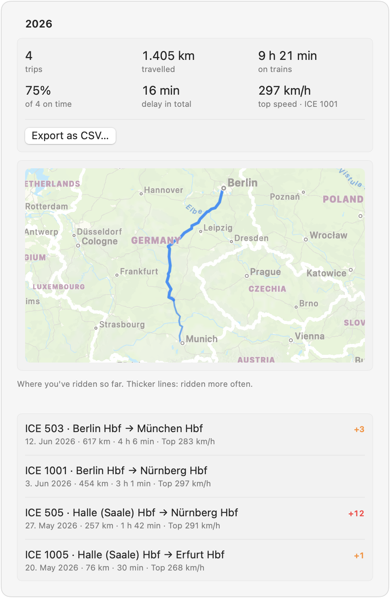

# Zugbar

Live train info in your Mac's menu bar.

<p align="center">
  <picture>
    <source media="(prefers-color-scheme: dark)" srcset="docs/screenshots/window-dark.png">
    
  </picture>
</p>

- **On board:** speed, next stop, delays, live GPS and tracks from the train's Wi-Fi.
- **Online:** follow any train in Europe via [Transitous](https://transitous.org), with estimated position and speed
- **Your journey:** when and where your train leaves while you wait, destination and connection, alerts for delays,
  track changes and tight or missed transfers
- **Trip log:** every ride with its speed and delays, your year in figures and a map of the lines you've ridden
- English and German

<p align="center">
  <picture>
    <source media="(prefers-color-scheme: dark)" srcset="docs/screenshots/panel-ice-dark.png">
    
  </picture>
  <picture>
    <source media="(prefers-color-scheme: dark)" srcset="docs/screenshots/panel-discover-dark.png">
    
  </picture>
  <picture>
    <source media="(prefers-color-scheme: dark)" srcset="docs/screenshots/panel-regional-dark.png">
    
  </picture>
</p>

<p align="center">
  <picture>
    <source media="(prefers-color-scheme: dark)" srcset="docs/screenshots/trips-dark.png">
    
  </picture>
</p>

> [!NOTE]
> Vibe-coded hobby project, mostly written by Claude and built on
> [TrainStatusInfo](https://github.com/niklaswa/TrainStatusInfo), [onboardapis](https://github.com/felix-zenk/onboardapis),
> [ICE-Buddy](https://github.com/ICE-Buddy) and [Transitous](https://transitous.org). The portals are unofficial
> APIs. Not affiliated with DB, ÖBB, SNCF or ČD.

## Install

Download the [latest release](https://github.com/zuranihenry/zugbar/releases/latest) and move `Zugbar.app` to
`/Applications` (macOS 14+). It isn't notarized; allow it under *System Settings → Privacy & Security*, or:

```bash
xattr -dr com.apple.quarantine /Applications/Zugbar.app
```

Or build it: `make install`.

## Development

```bash
make demo
make test
swift run Zugbar --lookup "ICE 123"
swift run Zugbar --profile "ICE 123"   # speed profile for the current section
```

Portals live in `Sources/ZugbarCore/Providers/`.

[MIT](LICENSE) · [Third-party notices](THIRD_PARTY_NOTICES.md)
