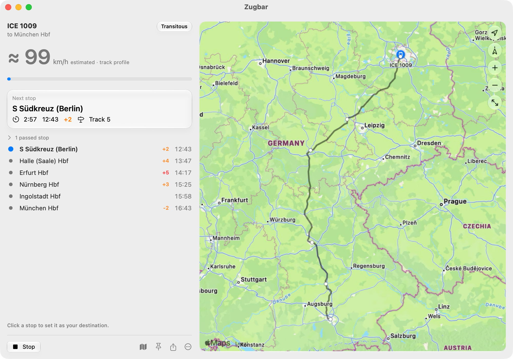
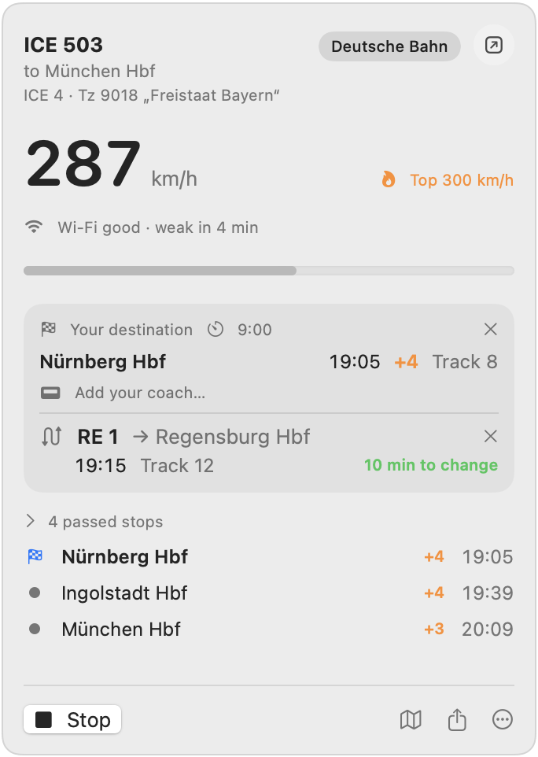
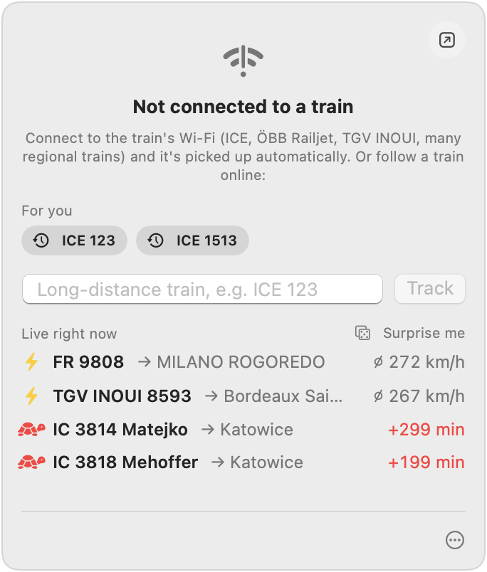
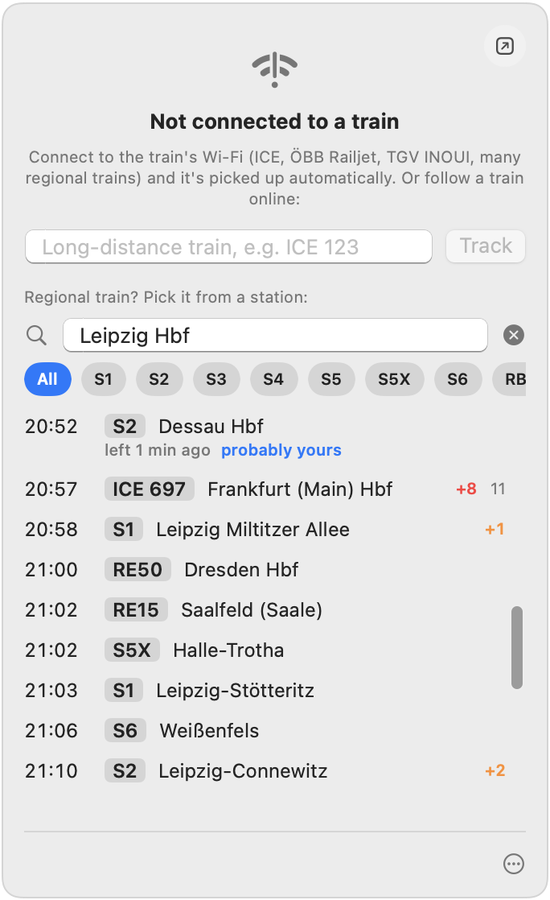

# Zugbar

Live train info in your Mac's menu bar.



- **On board:** speed, next stop, delays and tracks from the train's Wi-Fi (DB ICE, ÖBB Railjet, SNCF TGV INOUI), how
  well its internet actually works and when it will drop (learned from your own rides, kept on your Mac), and live GPS
  on trains with Icomera Wi-Fi such as DB Regio, which also tells which train you're on
- **Easy on capped Wi-Fi:** shows what's left of the train Wi-Fi's data limit and holds back downloads while there is one
- **Online:** follow any train in Europe via [Transitous](https://transitous.org), with estimated position and speed
- **Your journey:** when and where your train leaves while you wait, destination and connection, with alerts for delays,
  track changes and tight or missed transfers; took an SBB train instead (ECE)? Its Wi-Fi gives it away
- English and German

<table>
  <tr>
    <td valign="top"></td>
    <td valign="top"></td>
    <td valign="top"></td>
  </tr>
</table>

> [!NOTE]
> Vibe-coded hobby project, mostly written by Claude and built on
> [TrainStatusInfo](https://github.com/niklaswa/TrainStatusInfo), [onboardapis](https://github.com/felix-zenk/onboardapis),
> [ICE-Buddy](https://github.com/ICE-Buddy) and [Transitous](https://transitous.org). The portals are unofficial
> APIs. Not affiliated with DB, ÖBB or SNCF.

## Install

Download the [latest release](https://github.com/zuranihenry/zugbar/releases/latest) and move `Zugbar.app` to
`/Applications` (macOS 14+). It isn't notarized; allow it under *System Settings → Privacy & Security*, or:

```bash
xattr -dr com.apple.quarantine /Applications/Zugbar.app
```

Or build it: `make install`.

## Development

```bash
make demo
make test
swift run Zugbar --lookup "ICE 123"
swift run Zugbar --profile "ICE 123"   # speed profile for the current section
```

Portals live in `Sources/ZugbarCore/Providers/`. Settings → Debug can trigger every notification and simulate
delays on the demo train.

[MIT](LICENSE) · [Third-party notices](THIRD_PARTY_NOTICES.md)
