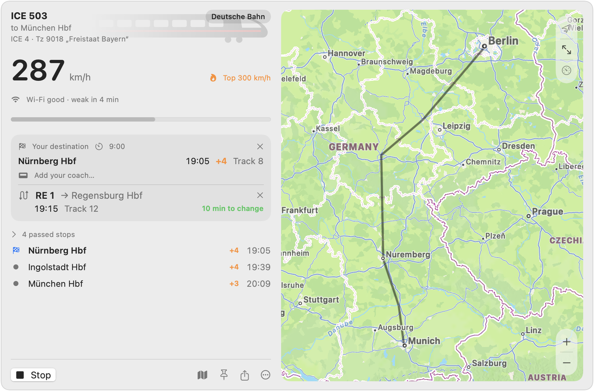
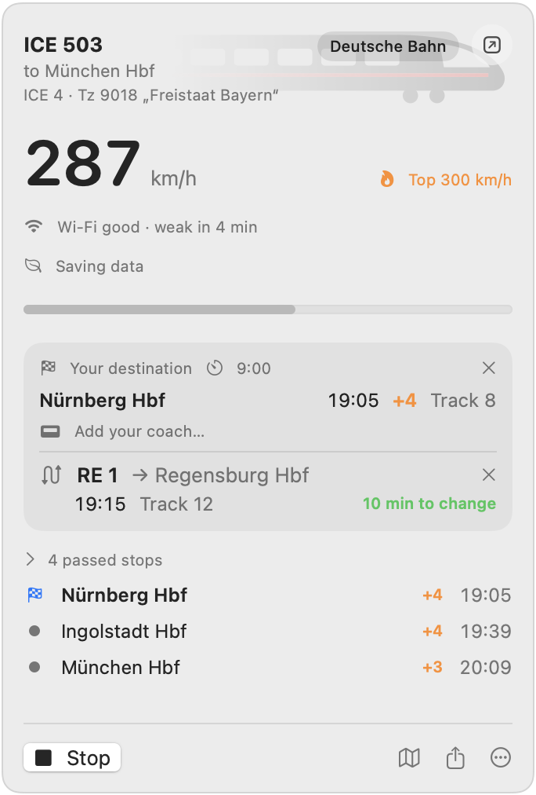
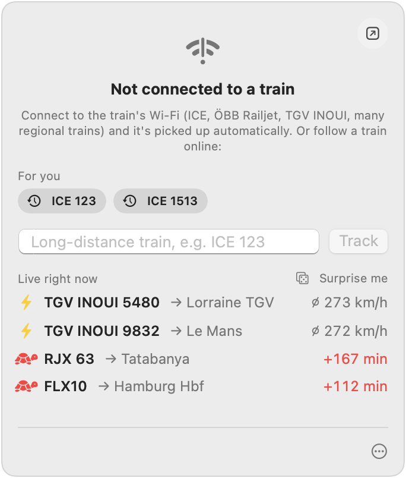
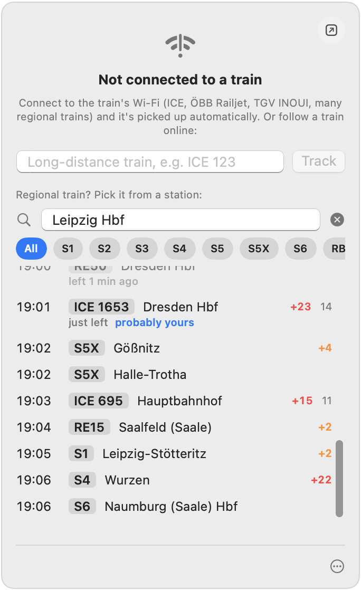

# Zugbar

Live train info in your Mac's menu bar.



- **On board:** speed, next stop, delays and tracks from the train's Wi-Fi (DB ICE, ÖBB Railjet, SNCF TGV INOUI;
  DB Regio and ČD too, written from the portals' known formats and not yet tried on a real train), how
  well its internet actually works and when it will drop (learned from your own rides, kept on your Mac), and live GPS
  on trains with Icomera Wi-Fi such as DB Regio, which also tells which train you're on
- **Map:** the route with your train moving along it, the track colored by its speed limit if you like, lighter on the
  battery when the Mac isn't plugged in, and under it the tunnel, bridge or river you're passing right now (offline)
- **Easy on capped Wi-Fi:** shows what's left of the train Wi-Fi's data limit and holds back downloads while there is one
- **Online:** follow any train in Europe via [Transitous](https://transitous.org), with estimated position and speed
- **Your journey:** when and where your train leaves while you wait, destination and connection, with alerts for delays,
  track changes and tight or missed transfers, and a hint that a refund may be due when you arrive an hour or more
  late; took an SBB train instead (ECE)? Its Wi-Fi gives it away
- **From your calendar, if you want:** off by default; switched on, Zugbar spots a connection that bahn.de or DB
  Navigator saved to your calendar and offers its stop and connection. Read on your Mac, with nothing kept from the
  calendar; only when you accept a suggestion is its station looked up online, as when you type it
- **Trip log:** every ride with its speed and delays, your year in figures and a map of the lines you've ridden, kept
  on your Mac, with CSV export; a ride stays one trip when the lid closes or the app restarts
- English and German

<table>
  <tr>
    <td valign="top"></td>
    <td valign="top"></td>
    <td valign="top"></td>
  </tr>
</table>

> [!NOTE]
> Vibe-coded hobby project, mostly written by Claude and built on
> [TrainStatusInfo](https://github.com/niklaswa/TrainStatusInfo), [onboardapis](https://github.com/felix-zenk/onboardapis),
> [ICE-Buddy](https://github.com/ICE-Buddy) and [Transitous](https://transitous.org). The portals are unofficial
> APIs. Not affiliated with DB, ÖBB, SNCF or ČD.

## Install

Download the [latest release](https://github.com/zuranihenry/zugbar/releases/latest) and move `Zugbar.app` to
`/Applications` (macOS 14+). It isn't notarized; allow it under *System Settings → Privacy & Security*, or:

```bash
xattr -dr com.apple.quarantine /Applications/Zugbar.app
```

Or build it: `make install`.

## Development

```bash
make demo
make test
swift run Zugbar --lookup "ICE 123"
swift run Zugbar --profile "ICE 123"   # speed profile for the current section
```

Portals live in `Sources/ZugbarCore/Providers/`. Settings → Debug can trigger every notification and simulate
delays on the demo train.

[MIT](LICENSE) · [Third-party notices](THIRD_PARTY_NOTICES.md)
